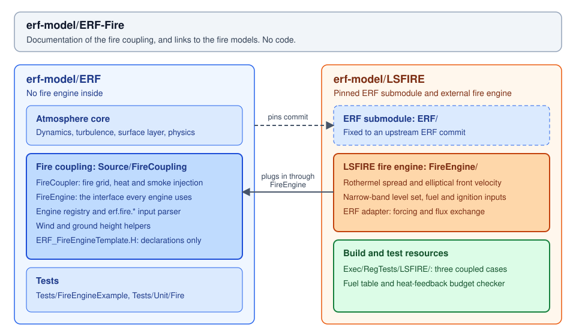

# LSFIRE fire engine for ERF

LSFIRE is a level-set wildland fire spread model built on
[AMReX](https://github.com/AMReX-Codes/amrex). It combines Rothermel surface
spread, an elliptical fire-front model, and an ELMFIRE-style narrow band to
advance a fire perimeter on a two-dimensional grid.

This repository couples LSFIRE to the
[ERF](https://github.com/erf-model/ERF) atmospheric model through ERF's shared
fire-engine interface: `erf.fire.engine = lsfire`. ERF supplies the atmospheric
forcing and handles the feedback of fire heat, water vapour, and smoke. LSFIRE
advances the fire and returns the surface fluxes.

The repository includes the LSFIRE core, its ERF adapter, an unmodified ERF as a
pinned git submodule, build scripts, and small coupled test cases. The core is
compiled into `erf_exec` using ERF's own AMReX; no separate
`libelmfire_core.a` is needed.

For the shared coupling and other fire models, see
[ERF-Fire](https://github.com/erf-model/ERF-Fire). For detailed test inputs,
reference results, and parameter notes, see the
[coupled-test README](../Exec/RegTests/LSFIRE/README.md).

The model formulation, idealized verification, and Palisades and Cram Fire
applications are described in our [model description paper](#model-description-paper).



## Model and coupling

The LSFIRE core provides:

- Rothermel surface fire spread with fuel, fuel-moisture, wind, and slope effects.
- Elliptical fire-front velocities for propagation in different directions.
- Level-set front tracking with limited gradients and second-order Runge–Kutta
  time integration in a narrow band around the front.
- Uniform fuel or LANDFIRE fuel IDs, and point or NetCDF area-mask ignition
  through the ERF adapter.
- Fire fields and time-averaged sensible-heat and water-vapour fluxes for output
  and atmospheric coupling.

The source also contains optional spotting and static multilevel fire-grid code.
Their presence does not imply validation through this ERF integration.

### Division of responsibilities

| Component | Responsibility |
|---|---|
| ERF atmosphere | Atmospheric dynamics, transport, turbulence, and other atmospheric physics |
| ERF shared fire coupling | Fire-grid setup, atmospheric forcing passed to the engine, flux averaging onto atmospheric columns, source placement, and smoke injection |
| LSFIRE adapter | Translation between ERF's `FireGrid` / `FireForcing` / `FireFluxes` interface and the LSFIRE core |
| LSFIRE core | Fuel and ignition state, spread physics, front propagation, and fire fluxes |

LSFIRE's fire grid refines ERF level 0 in the horizontal directions by
`erf.fire.grid_ratio`. For example, a ratio of 10 gives 10 m fire cells beneath
100 m atmospheric cells. This horizontal fire-grid refinement is independent of
atmospheric AMR.

### Wind and feedback

`fire.mode` selects the wind source:

| Mode | Behaviour |
|---|---|
| `constant_wind` | Uses prescribed `fire.constant_wind_u/v`, interpreted as the 20-ft wind |
| `atmospheric` | Uses ERF's lowest-cell wind (`k = 0`) and its height above local ground; the core converts it to the 20-ft wind with a log law |

Atmospheric wind is copied to the fire cells covered by each ERF cell and held
fixed during the fire update. `fire.atmos_wind_height` can override the actual
height for idealized tests. The two wind modes can therefore produce different
spread rates for the same numerical input wind speed.

With `erf.fire.coupling_type = passive`, heat and moisture do not feed back to
the atmosphere. With `lagged`, ERF applies the returned fluxes during the next
atmospheric step. The fire takes internal CFL steps, and the adapter averages
the fluxes over the update rather than returning only the final instantaneous
flux.

The current core assigns 75% of burning-cell reaction intensity to sensible
heat and 25% to latent heat. The adapter returns both to ERF in W/m², converting
the core's water-vapour mass flux to latent heat flux with ERF's `L_v`. ERF
controls vertical heat placement and Exner conversion; water-vapour feedback
requires an active moisture model. Smoke injection uses ERF's shared tracer
machinery and is configured separately under `erf.fire.*`.

## Repository layout

| Path | Contents |
|---|---|
| `ERF/` | Unmodified ERF submodule pinned to an upstream commit |
| `FireEngine/` | ERF adapter, fuel and ignition readers, and CMake / GNU make hooks |
| `FireEngine/LSFIRE/include/` | LSFIRE model API |
| `FireEngine/LSFIRE/src/Core/` | Fire engine, hierarchy, configuration, and output |
| `FireEngine/LSFIRE/src/Physics/` | Fuel models, Rothermel spread, elliptical front velocity, and spotting |
| `FireEngine/LSFIRE/src/Numerics/` | Gradients and level-set integration |
| `FireEngine/LSFIRE/src/DataStructures/` | Narrow-band data |
| `Exec/RegTests/LSFIRE/` | Coupled inputs, fuel table, analysis scripts, and documented reference results |
| `Build/` | CMake build script and Perlmutter environment setup |

The `ELMFIRE` names in some classes and files are retained implementation names.
The engine is registered with ERF as `lsfire`.

## Get the source

```bash
git clone https://github.com/erf-model/LSFIRE.git
cd LSFIRE
git submodule update --init ERF
git -C ERF submodule update --init Submodules/AMReX
```

AMReX is the only ERF submodule needed for the build below. Use the ERF commit
recorded by this repository to reproduce its dependency configuration.

## Build

The supplied script builds a three-dimensional, Release-mode executable
with MPI, NetCDF, and the LSFIRE engine enabled. It requires a compatible
C++ compiler, CMake, MPI, and NetCDF with its dependencies. See the
[ERF documentation](https://erf.readthedocs.io/) for platform-specific dependency
setup.

### Perlmutter

From the repository root:

```bash
source Build/env_perlmutter_cpu.sh
bash Build/cmake_cpu.sh build 16
```

The second argument is the number of build jobs. The executable is
`build/Exec/erf_exec`.

### Other systems

Set up your compiler, MPI, and NetCDF environment, then use the same build
script without sourcing the Perlmutter module setup:

```bash
bash Build/cmake_cpu.sh build 8
```

Equivalently, configure CMake directly from the repository root:

```bash
cmake -S ERF -B build \
  -DCMAKE_BUILD_TYPE=Release \
  -DERF_DIM=3 \
  -DERF_ENABLE_MPI=ON \
  -DERF_ENABLE_CUDA=OFF \
  -DERF_ENABLE_NETCDF=ON \
  -DERF_ENABLE_TESTS=OFF \
  -DERF_ENABLE_FIRE=ON \
  -DERF_FIRE_ENGINE_DIRS="$PWD/FireEngine"
cmake --build build --target erf_exec --parallel 8
```

If dependencies are outside the compiler's default search paths, supply their
locations using the corresponding ERF/CMake options. GNU make integration is
also available; see the [coupled-test README](../Exec/RegTests/LSFIRE/README.md).

## Run a first case

The atmospheric-wind case runs a grass fire driven by a uniform ERF wind with
passive coupling. From the repository root, copy the input and fuel table into
a separate run directory:

```bash
mkdir -p runs/atmos_wind
cp Exec/RegTests/LSFIRE/inputs_lsfire_atmos_wind runs/atmos_wind/
cp Exec/RegTests/LSFIRE/fuel_models.csv runs/atmos_wind/
cd runs/atmos_wind
../../build/Exec/erf_exec inputs_lsfire_atmos_wind > run.log 2>&1
```

This starts one MPI rank directly where supported. On a batch system, use the
site's launcher to run the executable with one rank.

The case covers a 6000 × 3000 × 400 m atmospheric domain with 100 m cells and
10 m fire cells. It uses GR2 fuel and a point ignition at (500, 1500) m. The
simulation advances for one hour and writes atmospheric plotfiles with prefix
`plt` and fire-grid plotfiles with prefix `fire_plt`.

The documented one-rank reference burned area at one hour is **146,700 m²**.
See the test README for the wind-height convention and reference details.

## Main inputs

Start from a complete input file in `Exec/RegTests/LSFIRE/`; the table below is
a guide to the main controls rather than a complete runnable configuration.

| Input | Purpose |
|---|---|
| `erf.fire.enable`, `erf.fire.engine` | Enable the fire and select `lsfire` |
| `erf.fire.grid_ratio` | Horizontal fire-grid refinement relative to ERF level 0 |
| `fire.mode` | Select prescribed or atmospheric wind |
| `erf.fire.coupling_type` | `passive` for no heat/moisture feedback; `lagged` for next-step feedback |
| `erf.fire.heat_profile` | `exponential` (ERF default) or `bottom_cell` heat placement |
| `fire.fuel_model_source` | `uniform` or `landfire` |
| `fire.uniform_fuel_id`, `fire.fuel_database_path` | Uniform fuel ID and fuel-table CSV path |
| `fire.nc_fuel_file` | NetCDF LANDFIRE fuel map, variable `FBFM` on the fire level-0 grid |
| `fire.fuel_moisture_1hr`, `10hr`, `100hr`, `live_herb`, `live_woody` | Moisture fractions; each suffix completes the `fire.fuel_moisture_` prefix |
| `fire.ignition_type` | `point` or `area`; area ignition requires a NetCDF mask |
| `fire.ignition_x/y`, `fire.ignition_radius`, `fire.ignition_time` | Point-ignition location, radius, and time |
| `fire.cfl`, `fire.band_thickness` | Internal fire time-step and narrow-band controls |
| `fire.subcycle_interval` | Update the fire every N atmospheric steps; N > 1 requires passive coupling |
| `erf.fire.plot_file`, `erf.fire.plot_int`, `erf.fire.plot_per` | Fire plotfile prefix and output intervals |

The detailed [parameter notes](../Exec/RegTests/LSFIRE/README.md#parameters) also
explain the replacement of older coupling keys. The adapter rejects several
obsolete names, including `fire.fire_ref_ratio`, `fire.bandthickness`, and
`fire.fire_dt`.

## Regression cases

The [coupled-test README](../Exec/RegTests/LSFIRE/README.md) records the following
reference checks with one MPI rank:

| Case | Purpose | Documented reference |
|---|---|---|
| `inputs_lsfire_constant_wind` | Compare the adapter with standalone LSFIRE on the same fire grid | Same burned cells at 1 h and 6 h; engine comparison of phi within 2e-10 |
| `inputs_lsfire_atmos_wind` | Check transfer of ERF wind and its height to the fire | Burned area 146,700 m² at 1 h |
| `inputs_lsfire_heat_feedback` | Check lagged sensible-heat and water-vapour budgets | Step-to-step flux transfer and atmospheric budgets, accounting for Exner conversion and the finite-height exponential profile |

The heat-feedback case uses `MoistNoCondensation`, coupling diagnostics, and fire
verbosity 2. To run it and inspect the budgets from the repository root:

```bash
mkdir -p runs/heat_feedback
cp Exec/RegTests/LSFIRE/inputs_lsfire_heat_feedback runs/heat_feedback/
cp Exec/RegTests/LSFIRE/fuel_models.csv runs/heat_feedback/
cd runs/heat_feedback
../../build/Exec/erf_exec inputs_lsfire_heat_feedback > run.log 2>&1
cd ../..
python3 -I Exec/RegTests/LSFIRE/check_heat_feedback_budget.py runs/heat_feedback
```

The budget script requires Python and NumPy. It prints relative budget errors;
compare them with the explanations and reference values in the test README.
Because the coupling has a one-step lag, the fire's final update has not yet
entered the atmosphere at the end of the run and is excluded from the matching
released-energy and water totals.

These are implementation and conservation checks for the documented cases.
They do not establish validation of every model option or of real-fire forecasts.

## Model description paper

If you use LSFIRE or ERF–LSFIRE in your research, please cite:

Liu, Y., Huang, H., Saltiel, T. M., Feng, S., Coleman, A., and Almgren, A. (2026).
**ERF-LSFIRE v1.0: Coupling a Level-Set Fire Model with the Energy Research and
Forecasting Model for Fire-Atmosphere Simulations.** *EGUsphere* [preprint].
[https://doi.org/10.5194/egusphere-2026-5430](https://doi.org/10.5194/egusphere-2026-5430).

The paper describes the model formulation and coupling strategy, verification
against analytical spread solutions over flat and sloping terrain, and
applications to the 2025 Palisades and Cram Fires. It is under review for
*Geoscientific Model Development*.

## Source origins

| Component | Origin |
|---|---|
| `FireEngine/LSFIRE/` | `liuye923/LSFIRE`, branch `multilevel_static`, commit `86e84af`: `include/` and `src/`, excluding the unused `NarrowBandTracker` |
| Adapter and coupled cases | `liuye923/ERF-LSFIRE` [PR #6](https://github.com/liuye923/ERF-LSFIRE/pull/6), commit `9d71a51be`; build files adapted to compile the bundled core |
| `ERF/` | `erf-model/ERF`, commit `1d14da148` from `development` |

The source tree records the exact ERF revision. When reporting a result, include
the LSFIRE and ERF commits, build configuration, MPI rank count, and input file.

## License

Files outside the `ERF/` submodule are distributed under the BSD 3-Clause
license; see [LICENSE.md](../LICENSE.md). Copyright is held by Battelle Memorial
Institute, operator of Pacific Northwest National Laboratory, and the Rector
and Visitors of the University of Virginia. The `ERF/` submodule retains
[ERF's own license](../ERF/LICENSE.md).
